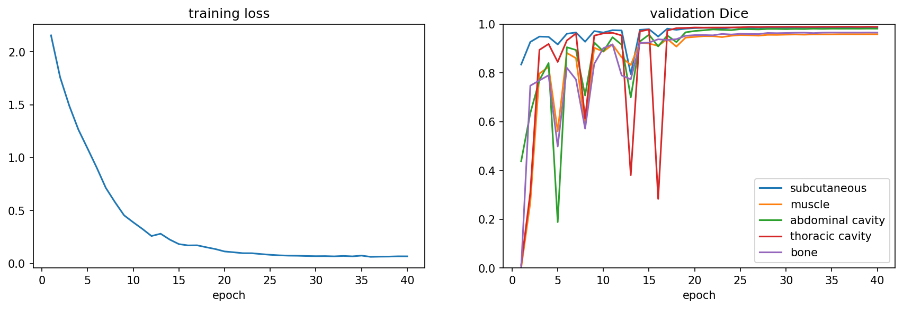

# CT Body Composition Pipeline

A from-scratch PyTorch pipeline that segments CT scans into **subcutaneous fat, skeletal muscle, abdominal cavity, thoracic cavity and bone**, as the foundation for measuring body composition over time.

**Status:** Phase 1 in progress. Data pipeline and a 2D U-Net are working (test Dice 0.97 mean). Body composition metrics in cm² and larger-scale training are next.

---

## Why

Body composition changes (loss of muscle and bone, shifts in fat) can show up on routine CT long before a disease is diagnosed. Most tools measure a single slice (L3) at a single time point. The longer-term goal of this project is to measure body composition **across many slices and across a patient's serial scans**, and to ask whether those trajectories carry early signal for aggressive cancers.

- **Phase 1 (this repo, now):** a reliable segmentation and measurement pipeline.
- **Phase 2 (planned):** apply it to longitudinal public CT data (for example, serial screening CTs) to study trajectories before diagnosis.

---

## Pipeline

| Step | Notebook | What it does |
|---|---|---|
| 1 | [`01_get_saros_data.ipynb`](notebooks/01_get_saros_data.ipynb) | Downloads SAROS masks + matching CTs from TCIA (public collections only), checks image/mask alignment |
| 2 | [`02_preprocess.ipynb`](notebooks/02_preprocess.ipynb) | Standardizes orientation, keeps annotated slices, remaps labels, stores raw HU per slice |
| 3 | [`03_train_unet.ipynb`](notebooks/03_train_unet.ipynb) | Trains a 2D U-Net (written from scratch) with Dice + cross-entropy loss, evaluates on a held-out test set |
| 4 | coming | Per-slice and per-vertebral-level areas in cm², VAT from fat HU inside the abdominal cavity |
| 5 | coming | Comparison against TotalSegmentator; scale-up to all public SAROS cases |

All notebooks run on Google Colab (free T4 GPU) with data stored on Google Drive.

---

## Results (first run)

**Data:** 47 CTs from SAROS (first 50 publicly downloadable cases; 3 failed to download). Only annotated slices are used (SAROS labels every 5th axial slice): 768 slices total.

**Split:** SAROS's own predefined split. Test = SAROS `test` cases (9 cases, 140 slices), never used until the final evaluation. Validation = SAROS `fold-5` (used only to pick the best epoch). Training = remaining folds.

**Model:** 2D U-Net, 4 levels, 7.8 M parameters, 2-channel input (soft-tissue window and wide window). Trained at 256×256 for 40 epochs (~5 min on a T4). Test predictions are upsampled to 512×512 before scoring.

| Class | Test Dice |
|---|---|
| Subcutaneous fat | 0.980 |
| Skeletal muscle | 0.948 |
| Abdominal cavity | 0.978 |
| Thoracic cavity | 0.983 |
| Bone | 0.941 |
| **Mean (foreground)** | **0.966** |

The early dips in validation Dice come from the one-cycle learning-rate schedule (large steps while the rate is high); the best epoch is chosen on validation, not the last one.

### Limitations (so far)

- **Small test set** (9 cases) drawn from the same TCIA collections as training. This is an internal test, not external validation.
- **Dice measures overlap with SAROS annotations**, not the accuracy of body composition areas in cm². That is checked in step 4.
- Trained at 256×256 for speed; full-resolution training may improve thin structures (muscle, bone).

---

## Reproduce

1. Download from the [SAROS TCIA page](https://doi.org/10.25737/SZ96-ZG60): the **SAROS Segmentations** (NIfTI) and the **Segmentation Information Spreadsheet** (CSV).
2. In Google Drive, create `MyDrive/ct-body-comp/raw/`. Put the unzipped segmentation folder there as `data/`, plus the CSV.
3. Open the notebooks in Colab and run them in order (01 → 02 → 03). Notebook 03 needs a GPU runtime.

Outputs land in `MyDrive/ct-body-comp/processed/` and `MyDrive/ct-body-comp/models/`.

---

## Data

This repository contains **code only**. No images or segmentations are redistributed.

- **SAROS** segmentations: CC BY 4.0.
- **Source CT images** come from multiple TCIA collections with their own licenses (including CC BY 3.0, CC BY-NC 3.0, and some under the NIH Controlled Data Access Policy). Only publicly downloadable collections are used here.

### Citations

Koitka, S., Baldini, G., Kroll, L., van Landeghem, N., Haubold, J., Sung Kim, M., Kleesiek, J., Nensa, F., & Hosch, R. (2023). *SAROS: A large, heterogeneous, and sparsely annotated segmentation dataset on CT imaging data* (Version 2) [Data set]. The Cancer Imaging Archive. https://doi.org/10.25737/SZ96-ZG60

Koitka, S., et al. (2024). SAROS: A dataset for whole-body region and organ segmentation in CT imaging. *Scientific Data*, 11, 483. https://doi.org/10.1038/s41597-024-03337-6

Clark, K., Vendt, B., Smith, K., Freymann, J., Kirby, J., Koppel, P., Moore, S., Phillips, S., Maffitt, D., Pringle, M., Tarbox, L., & Prior, F. (2013). The Cancer Imaging Archive (TCIA): Maintaining and Operating a Public Information Repository. *Journal of Digital Imaging*, 26(6), 1045–1057. https://doi.org/10.1007/s10278-013-9622-7

---

## Author

**Aarohi Bhatt, MBBS**. MS Computer Science, Columbia University. [aarohi-bhatt.github.io](https://aarohi-bhatt.github.io)

Code: MIT License (see [LICENSE](LICENSE)).
