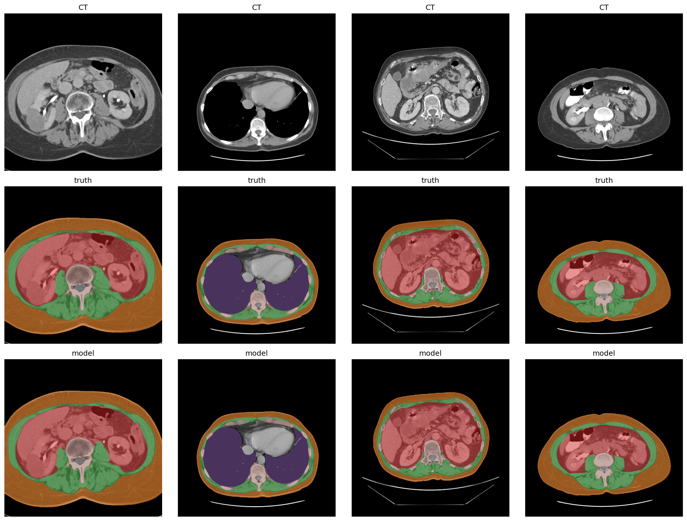
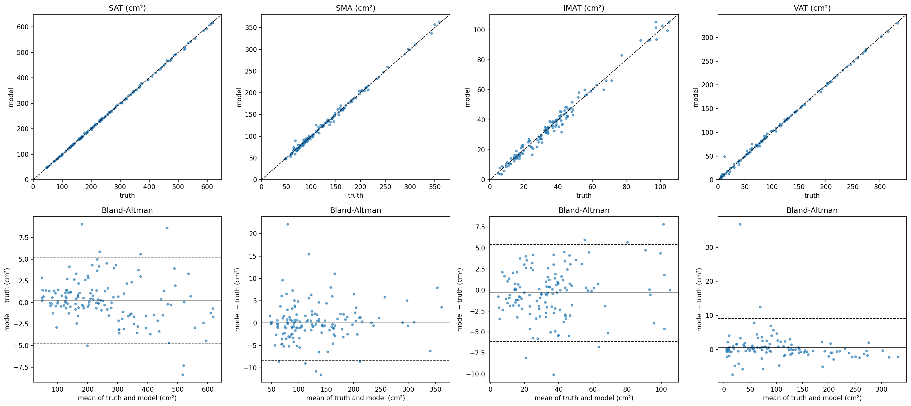
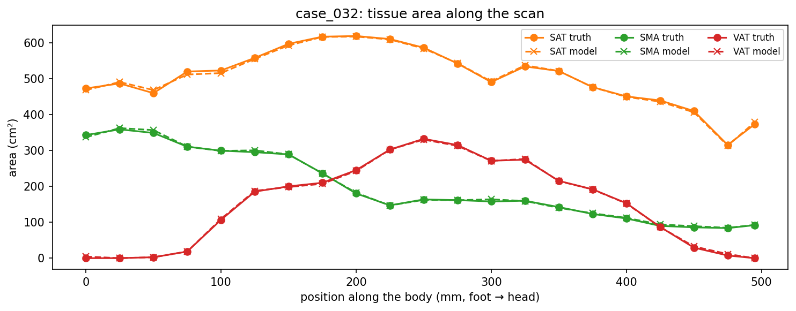
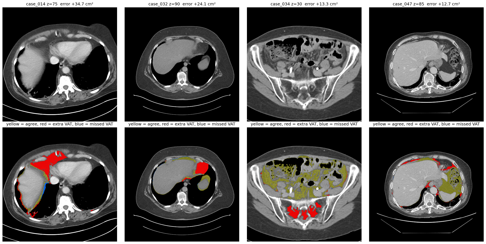
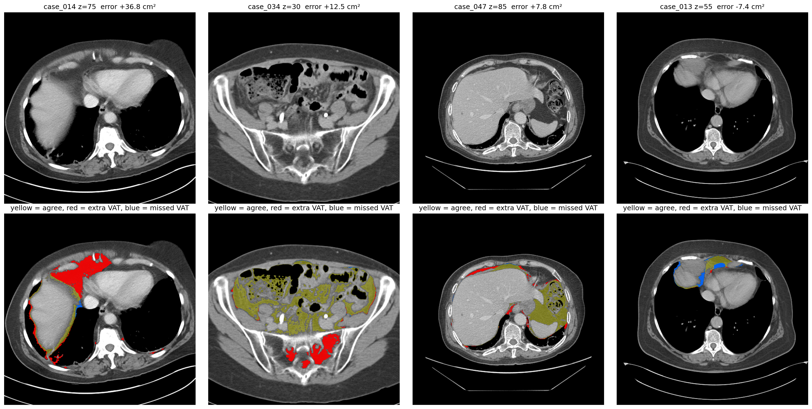
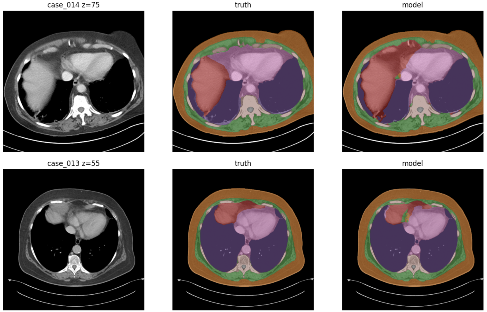

# CT Body Composition Pipeline

A from-scratch PyTorch pipeline that segments CT scans into **subcutaneous fat, skeletal muscle, abdominal cavity, thoracic cavity, mediastinum and bone**, and turns the masks into body composition measurements (cm² and HU) across many slices, as the foundation for measuring body composition over time.

**Status:** Phase 1 in progress. Segmentation (test Dice 0.96 mean) and body composition measurement (muscle area within 0.2 cm² bias of the reference) are working. Next: 2.5D context for the diaphragm boundary, and larger-scale training.

---

## Why

Body composition changes (loss of muscle and bone, shifts in fat) can show up on routine CT long before a disease is diagnosed. Most tools measure a single slice (L3) at a single time point. The longer-term goal of this project is to measure body composition **across many slices and across a patient's serial scans**, and to ask whether those trajectories carry early signal for aggressive cancers.

- **Phase 1 (this repo, now):** a reliable segmentation and measurement pipeline.
- **Phase 2 (planned):** apply it to longitudinal public CT data (for example, serial screening CTs) to study trajectories before diagnosis.

---

## Pipeline

| Step | Notebook | What it does |
|---|---|---|
| 1 | [`01_get_saros_data.ipynb`](notebooks/01_get_saros_data.ipynb) | Downloads SAROS masks + matching CTs from TCIA (public collections only), checks image/mask alignment |
| 2 | [`02_preprocess.ipynb`](notebooks/02_preprocess.ipynb) | Standardizes orientation, keeps annotated slices, remaps labels, stores raw HU per slice |
| 3 | [`03_train_unet.ipynb`](notebooks/03_train_unet.ipynb) | Trains a 2D U-Net (written from scratch) with Dice + cross-entropy loss, evaluates on a held-out test set |
| 4 | [`04_body_composition.ipynb`](notebooks/04_body_composition.ipynb) | Converts masks to SAT, muscle (SMA), IMAT and VAT areas in cm², muscle and bone HU; compares model vs reference; error analysis |
| 5 | coming | 2.5D input (neighbouring slices) for the diaphragm; comparison against TotalSegmentator; scale-up to all public SAROS cases |

All notebooks run on Google Colab (free T4 GPU) with data stored on Google Drive. Notebooks 02 to 04 have a `VERSION` switch: `'v1'` reproduces the first run, `'v2'` (current) adds the mediastinum class described below.

---

## Data and setup

- **Data:** 47 CTs from SAROS (first 50 publicly downloadable cases; 3 failed to download). Only annotated slices are used (SAROS labels every 5th axial slice): 768 slices total.
- **Split:** SAROS's own predefined split. Test = SAROS `test` cases (9 cases, 140 slices), never used until the final evaluation. Validation = SAROS `fold-5` (used only to pick the best epoch). Training = remaining folds.
- **Model:** 2D U-Net, 4 levels, 7.8 M parameters, 2-channel input (soft-tissue window and wide window). Trained at 256×256 for 40 epochs (~6 min on a T4). Test predictions are upsampled to 512×512 before scoring.

---

## Results

### 1. Segmentation (test Dice)

| Class | v1 | v2 (current) |
|---|---|---|
| Subcutaneous fat | 0.980 | 0.979 |
| Skeletal muscle | 0.948 | 0.946 |
| Abdominal cavity | 0.978 | 0.977 |
| Thoracic cavity | 0.983 | 0.983 |
| Bone | 0.941 | 0.936 |
| Mediastinum | n/a | 0.940 |

Differences between v1 and v2 on the shared classes are within run-to-run variation.

The early dips in validation Dice come from the one-cycle learning-rate schedule (large steps while the rate is high); the best epoch is chosen on validation, not the last one.

### 2. Body composition (does the model get the cm² right?)

Dice measures overlap; clinicians need areas and densities. Each test slice is measured twice, from the reference mask and from the model's mask, with the same rule: **the mask says where, HU says what tissue.**

| Metric | Region (mask) | HU window |
|---|---|---|
| SAT | subcutaneous | −190 to −30 |
| SMA (skeletal muscle area) | muscle | −29 to 150 |
| IMAT (inter/intramuscular fat) | muscle | −190 to −30 |
| VAT (visceral fat) | abdominal cavity | −190 to −30 |
| Muscle HU | muscle (muscle-range pixels) | mean |
| Bone HU | bone | mean |

Agreement on 140 test slices (v2; area metrics use slices with reference area ≥ 5 cm²):

| Metric | r | Bias (model − reference) | 95% limits of agreement | Mean abs. % error |
|---|---|---|---|---|
| SAT (cm²) | 1.000 | +0.26 | −4.7 to +5.2 | 0.8% |
| **SMA (cm²)** | **0.998** | **+0.21** | −8.3 to +8.7 | **2.7%** |
| IMAT (cm²) | 0.992 | −0.33 | −6.1 to +5.4 | 8.2% |
| VAT (cm²) | 0.999 | +0.53 | −8.0 to +9.1 | 7.0% |
| Muscle HU | 0.997 | +0.03 | −2.1 to +2.2 | 1.9% |
| Bone HU | 0.989 | −0.35 | −28.8 to +28.1 | 3.7% |

**The multi-slice idea:** tissue area along one test patient's scan, reference vs model. Comparing these curves between a patient's serial scans, aligned by vertebral level, is the trajectory measurement Phase 2 needs.

### 3. Error analysis: v1 → v2

**v1 finding.** The largest VAT errors clustered at the diaphragm. Pericardial and epicardial fat was labelled as abdominal cavity (so counted as VAT). Cause: v1 mapped SAROS's pericardium and mediastinum labels to background, so the model was never taught that this fat belongs to its own region.

**v2 fix.** Added a mediastinum class (SAROS pericardium + mediastinum). Effect on v1's worst slices (full table: [`results/vat_worst_slices_v1_vs_v2.csv`](results/vat_worst_slices_v1_vs_v2.csv)):

| Slice | Region | VAT error v1 (cm²) | v2 (cm²) |
|---|---|---|---|
| case_032 z=90 | epicardial fat pad | +24.1 | **+3.4** |
| case_047 z=85 | subdiaphragmatic rim | +12.7 | **+7.8** |
| case_034 z=30 | presacral pelvis | +13.3 | +12.5 (not targeted) |
| case_014 z=75 | cardiophrenic angle | +34.7 | +36.8 |

Overall VAT bias fell from +1.37 to +0.53 cm²; other metrics were unchanged.

**What remains: the cardiophrenic angle.** In case_014 the reference labels the fat between the liver dome and the heart as mediastinum, and the model calls it abdominal cavity. In case_013 the reverse happens: the reference calls fat next to the liver dome abdominal cavity, and the model gives part of it to mediastinum. Both references look anatomically defensible; what separates them is the **diaphragm**, a thin muscle that lies nearly parallel to the slice at the dome and is often invisible on a single axial image. A 2D model sees one slice and has to guess, and its errors go in both directions. A radiologist resolves this by scrolling through neighbouring slices, which motivates the next step: **2.5D input** (the slice plus its neighbours as extra channels).

---

## Limitations (so far)

- **Small test set** (9 cases) from the same TCIA collections as training. This is an internal test, not external validation.
- **Reference and model share the same HU thresholds**, so the agreement table measures segmentation error only, not error from the threshold definitions themselves.
- **VAT includes bowel contents** in the fat HU range (for example, stool), in both reference and model.
- **Diaphragm and pelvic boundaries** of the abdominal cavity drive most VAT error (see above). At L3, the classic single-slice level, these errors do not occur.
- **Bone HU** is unbiased on average but noisy per slice (±28 HU), because edge pixels mix bone with soft tissue. A vertebral-body-only measure would be cleaner.
- Trained at 256×256 for speed; full-resolution training may improve thin structures (muscle, bone).

---

## Reproduce

1. Download from the [SAROS TCIA page](https://doi.org/10.25737/SZ96-ZG60): the **SAROS Segmentations** (NIfTI) and the **Segmentation Information Spreadsheet** (CSV).
2. In Google Drive, create `MyDrive/ct-body-comp/raw/`. Put the unzipped segmentation folder there as `data/`, plus the CSV.
3. Open the notebooks in Colab and run them in order (01 → 02 → 03 → 04). Notebook 03 needs a GPU runtime. Set `VERSION` in 02 to 04 to choose v1 or v2.

Outputs land in `MyDrive/ct-body-comp/processed[_v2]/`, `models[_v2]/` and `figures[_v2]/`. Result tables for both versions are in [`results/`](results/) (v1 in `results/v1/`).

---

## Data

This repository contains **code only**. No images or segmentations are redistributed.

- **SAROS** segmentations: CC BY 4.0.
- **Source CT images** come from multiple TCIA collections with their own licenses (including CC BY 3.0, CC BY-NC 3.0, and some under the NIH Controlled Data Access Policy). Only publicly downloadable collections are used here.

### Citations

Koitka, S., Baldini, G., Kroll, L., van Landeghem, N., Haubold, J., Sung Kim, M., Kleesiek, J., Nensa, F., & Hosch, R. (2023). *SAROS: A large, heterogeneous, and sparsely annotated segmentation dataset on CT imaging data* (Version 2) [Data set]. The Cancer Imaging Archive. https://doi.org/10.25737/SZ96-ZG60

Koitka, S., et al. (2024). SAROS: A dataset for whole-body region and organ segmentation in CT imaging. *Scientific Data*, 11, 483. https://doi.org/10.1038/s41597-024-03337-6

Clark, K., Vendt, B., Smith, K., Freymann, J., Kirby, J., Koppel, P., Moore, S., Phillips, S., Maffitt, D., Pringle, M., Tarbox, L., & Prior, F. (2013). The Cancer Imaging Archive (TCIA): Maintaining and Operating a Public Information Repository. *Journal of Digital Imaging*, 26(6), 1045–1057. https://doi.org/10.1007/s10278-013-9622-7

---

## Author

**Aarohi Bhatt, MBBS**. MS Computer Science, Columbia University. [aarohi-bhatt.github.io](https://aarohi-bhatt.github.io)

Code: MIT License (see [LICENSE](LICENSE)).
